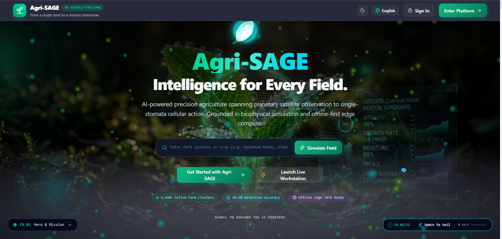
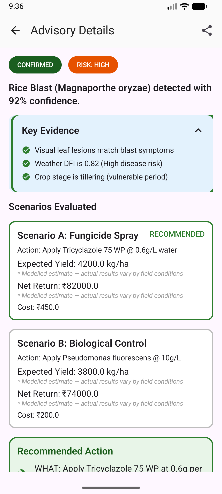
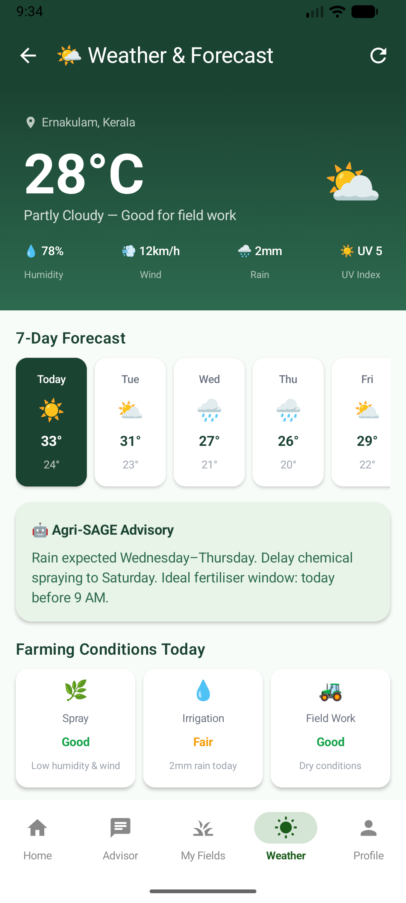
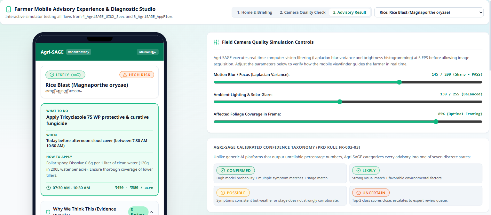

# 🌾 Agri-SAGE (Scalable Agricultural Guidance Engine)

[](#)
[](#)
[](#)
[](#)
[](#)

**Agri-SAGE** (*Scalable Agricultural Guidance Engine*) is an enterprise-grade, offline-first, simulation-grounded, multi-agent agricultural intelligence platform engineered for smallholder farmers, Krishi Vigyan Kendra (KVK) extension officers, and institutional agronomists across India and global developing markets.

The platform unifies:
1. **On-Device Vision Diagnostics**: EfficientNet-B3 ONNX disease classification pipeline.
2. **Physics-Based Crop Growth Simulation**: DSSAT CSM biophysical modeling engine.
3. **Statutory Chemical Safety Verification**: Automatic CIB&RC compliance checking against dangerous pesticide recommendations.
4. **14-Agent LangGraph Orchestration**: Calibrated confidence scoring with human-in-the-loop agronomist triage.
5. **Multilingual Regional Support**: Native voice and text in Malayalam, English, Hindi, Tamil, and Telugu.

---

## 🏗️ System Architecture

```
                      [ Farmer Mobile App (Android / Compose) ]
                                      │
                         (REST / WebSockets / Offline Sync)
                                      ▼
                      [ FastAPI Core Gateway (v1 API) ]
                                      │
            ┌─────────────────────────┼─────────────────────────┐
            ▼                         ▼                         ▼
   [ 14 LangGraph Agents ]   [ Physics Simulation ]     [ Knowledge RAG ]
   - Vision & Symptom        - DSSAT CSM Biophysics     - ICAR / KAU Handbooks
   - Weather & Microclimate  - GDD Growth Stages        - CIB&RC Safety DB
   - Scheme & Subsidy        - Soil Water Balance       - pgvector Hybrid Search
   - Agronomist Triage Critic
            │
            ▼
   [ PostgreSQL + pgvector + Alembic Migrations ]
```

---

## 📱 Mobile Client & Agronomist Workstation

- **Farmer Mobile App (`AgriSage/mobile/`)**: Native Android app built with Kotlin, Jetpack Compose, CameraX real-time quality analyzer, Room SQLite offline database, and Bhashini speech player.
- **Agronomist Triage Workstation (`AgriSage/apps/web-expert/`)**: Web workstation built with React, Vite, TypeScript, and Tailwind CSS for extension officers to review escalated cases.
- **Backend Services (`AgriSage/backend/`)**: High-performance FastAPI server orchestrating the 14-agent LangGraph workflow.

---

## 📁 Directory Structure

```
AgriSage/
├── AgriSage/                  # Core application monorepo
│   ├── backend/               # FastAPI backend & 14 LangGraph agent implementations
│   ├── mobile/                # Android Jetpack Compose native mobile client
│   ├── apps/web-expert/       # Agronomist Triage Workstation (React + Vite)
│   ├── alembic/               # Database migration scripts (001–017)
│   ├── docs/                  # Full PRD, TRD, Schema & Security specifications
│   ├── docker-compose.yml     # Local orchestration configuration
│   └── requirements.txt       # Backend dependencies
├── AgriSage_document_files/   # System documentation, PRD and architecture artifacts
├── docs_text/                 # Extracted text references and agronomy standards
├── adapters/                  # Integration adapters
├── scripts/                   # Utility and diagnostic scripts
├── screenshots/               # Application UI and architecture screenshots
├── PROJECT_RULES.md           # Engineering principles & coding standards
└── README.md                  # Root documentation
```

---

## 🖼️ Application Interface & System Previews

<div align="center">
  
</div>

<br/>

| Disease Diagnosis & Advisory | Microclimate & Weather Forecast | Agronomist Expert Triage |
| :---: | :---: | :---: |
|  |  |  |

---

## 🚀 Quick Start Guide

```bash
cd AgriSage

# 1. Environment configuration
cp .env.example .env

# 2. Start services with Docker
docker compose up -d

# 3. Apply database migrations
alembic upgrade head

# 4. Start backend server
uvicorn backend.main:app --reload
```

---

## 📄 License
This project is licensed under the Apache License 2.0 — see the [LICENSE](AgriSage/LICENSE) file for details.
