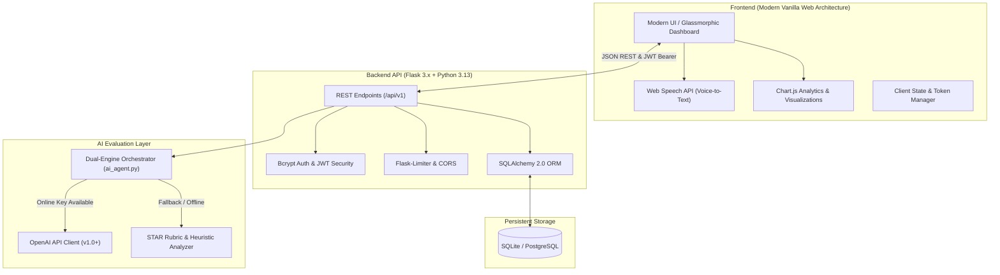

# 🎯 AI Interview Coach — Enterprise Preparation & Assessment Platform

[](https://github.com/placeholder/ai-interview-coach/actions)
[](https://www.python.org/)
[](https://flask.palletsprojects.com/)
[](https://platform.openai.com/)
[](LICENSE)
[](https://github.com/psf/black)

> **An intelligent, real-time interview preparation platform combining modern speech recognition, automated AI feedback, and deep competency analytics.**

Designed for engineers, designers, and job seekers to practice technical and behavioral interviews with actionable, objective grading based on industry-standard rubrics (STAR method, system architecture depth, communication clarity, and technical correctness).

---

## 🌟 Key Features

### 🎙️ 1. Real-Time Voice & Speech Recognition
- Seamless speech-to-text powered by the native browser **Web Speech API**.
- Real-time visual feedback and speech transcription directly into the response editor.
- Audio toggle support allows users to type, dictate, or review their spoken responses before submission.

### 🧠 2. Dual-Engine AI Evaluation
- **Live OpenAI Engine (v1.0+)**: Evaluates responses using advanced LLM reasoning, returning structured JSON grading across Overall Score (0-100), Clarity, Technical Depth, Actionability, and tailored recommendations.
- **Resilient Heuristic Fallback Engine**: If no OpenAI API key is supplied or network requests are restricted, the platform automatically switches to a deterministic STAR method (Situation, Task, Action, Result) rubric and keyword density analyzer—guaranteeing **100% uptime and zero breaking errors** during demos or offline environments.

### 📊 3. Interactive Competency Analytics & Radar Charts
- Visual score trends over time powered by **Chart.js**.
- Detailed category mastery radar diagrams (System Design, Frontend, Backend, Behavioral, Algorithms).
- Practice duration tracking, average score benchmarks, and past session review history.

### 📚 4. Dynamic Multi-Domain Question Bank
- Filter questions by difficulty (*Beginner*, *Intermediate*, *Advanced*) and category (*Behavioral*, *Technical*, *System Design*, *DevOps*).
- Live search query filtering and on-the-fly practice launching directly from the Question Library.

### 🔒 5. Enterprise-Ready Backend Architecture
- **JWT-Protected RESTful API**: Built with Flask 3.x, Flask-JWT-Extended, and Flask-CORS.
- **Robust Security**: Bcrypt password hashing, rate limiting with Flask-Limiter, and structured logging.
- **Flexible Database Layer**: SQLAlchemy 2.x ORM supporting local SQLite development out of the box and production PostgreSQL migration with zero configuration changes.
- **Static Hosting Friendly**: Dual-mode frontend architecture connects dynamically to local/remote Flask backends or runs seamlessly in standalone evaluation mode for static hosting (e.g., GitHub Pages).

---

## 📐 System Architecture



---

## 🗂️ Project Directory Structure

```text
Ai_Interview_Coach/
├── .github/
│   └── workflows/
│       └── ci.yml               # Automated GitHub Actions test pipeline
├── ai_interview_coach_docx/     # Formal SRS documentation & PDF exports
│   ├── SRS_AI_INTERVIEW_COACH.md
│   └── DELIVERY_MANIFEST.md
├── backend/
│   ├── app.py                   # Main Flask REST application & routing
│   ├── ai_agent.py              # Dual-Engine AI evaluation orchestrator
│   ├── requirements.txt         # Core production Python dependencies
│   ├── requirements_enterprise.txt # Extended enterprise ML/queue dependencies
│   ├── .env.example             # Environment configuration template
│   ├── setup_database.py        # Database migration & question seeder
│   └── tests/
│       └── test_api.py          # Pytest automated API test suite
├── frontend/
│   ├── index.html               # Landing page & feature showcase
│   ├── login.html               # Authentication portal
│   ├── signup.html              # User registration portal
│   ├── dashboard.html           # Core practice dashboard & analytics
│   ├── style.css                # Premium responsive design system
│   └── script.js                # Client logic, voice recognition & charts
├── .gitignore                   # Enterprise git ignore specifications
├── LICENSE                      # MIT Open Source License
└── README.md                    # Project documentation & presentation
```

---

## 🚀 Quickstart Guide

### Prerequisites
- **Python 3.10+** (tested up to Python 3.13)
- Modern Web Browser (Google Chrome, Edge, Safari, Firefox)

### 1. Clone the Repository
```bash
git clone https://github.com/your-username/ai-interview-coach.git
cd ai-interview-coach
```

### 2. Set Up Backend
```bash
cd backend

# Create and activate virtual environment
python -m venv venv

# Windows (PowerShell):
.\venv\Scripts\Activate.ps1
# macOS/Linux:
source venv/bin/activate

# Install dependencies
pip install -r requirements.txt

# Configure environment variables (optional for local dev)
copy .env.example .env    # Windows
cp .env.example .env      # Linux/macOS
```

### 3. Initialize Database & Seed Questions
```bash
python setup_database.py
```

### 4. Run the Development Server
```bash
python app.py
```
The backend server will launch at `http://127.0.0.1:5000`.

### 5. Open the Frontend
- If running the Flask server, visit: **`http://127.0.0.1:5000/`** (Flask serves the frontend directly).
- Alternatively, you can open `frontend/index.html` or `frontend/dashboard.html` directly in your browser. The frontend auto-detects whether the backend API is live or running in local demonstration mode.

---

## 🧪 Automated Testing

The project includes an automated test suite verifying authentication, question delivery, answer submission, score evaluation, and analytics endpoints:

```bash
cd backend
pytest tests/test_api.py -v
```

**Expected output:**
```text
tests/test_api.py::test_health_check PASSED                               [ 20%]
tests/test_api.py::test_auth_registration_and_login PASSED                [ 40%]
tests/test_api.py::test_get_questions PASSED                             [ 60%]
tests/test_api.py::test_submit_answer_and_evaluate PASSED                 [ 80%]
tests/test_api.py::test_analytics_and_stats PASSED                        [100%]
============================== 5 passed in 3.50s ===============================
```

---

## 🔌 API Reference Summary

| Method | Endpoint | Description | Auth Required |
| :--- | :--- | :--- | :---: |
| `GET` | `/health` | Server health and engine diagnostic check | No |
| `POST` | `/api/auth/register` | Register a new candidate account | No |
| `POST` | `/api/auth/login` | Authenticate user & receive JWT token | No |
| `GET` | `/api/questions` | List interview questions (supports `?category=` filter) | Optional |
| `POST` | `/api/answers/submit` | Submit response for automated AI evaluation | Optional |
| `GET` | `/api/analytics/summary` | User competency and practice summary statistics | Optional |
| `GET` | `/api/interviews/history`| List completed interview sessions & grades | Optional |
| `GET` | `/api/leaderboard` | Top performers ranked by interview grade | No |

---

## 💡 Evaluation Rubric

Every candidate response is graded across four core competencies:

1. **Clarity & Structure (25%)**: Organization, clear thesis, logical flow, and avoidance of filler words.
2. **Technical Depth & Accuracy (35%)**: Use of domain-appropriate terminology, architectural principles, algorithms, and practical trade-off analysis.
3. **STAR Method Alignment (25%)**: Contextualization of Situation, Task, Action taken, and measurable Results.
4. **Actionable Delivery & Brevity (15%)**: Conciseness, directness, and executive presentation.

---

## 📄 License

This project is licensed under the [MIT License](LICENSE) — see the LICENSE file for details.

---

## 👥 Authors & Acknowledgments

- **Lead Developer**: Built with dedication to high-standard software engineering and modern AI development.
- **Contributions**: Pull requests, feature requests, and feedback are welcome!
